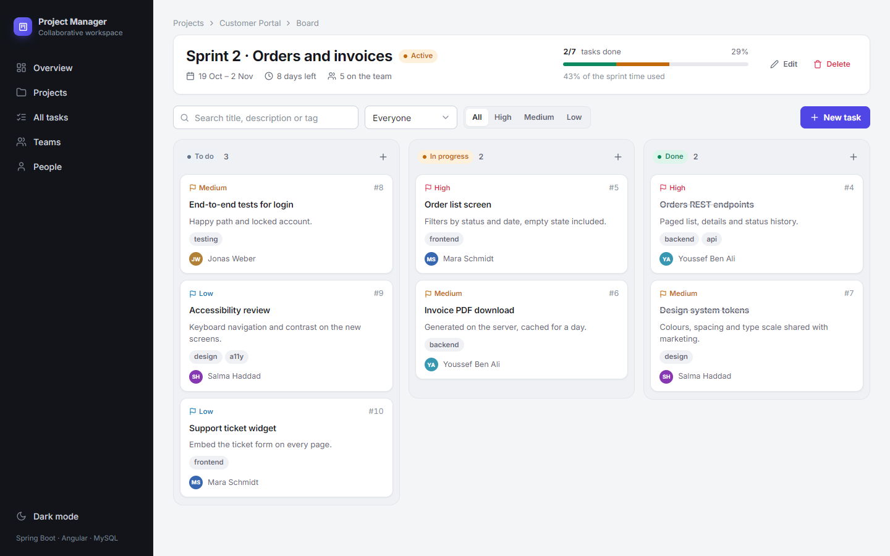
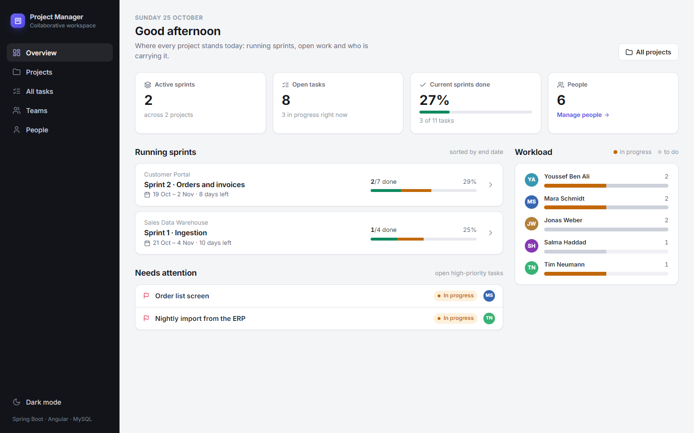
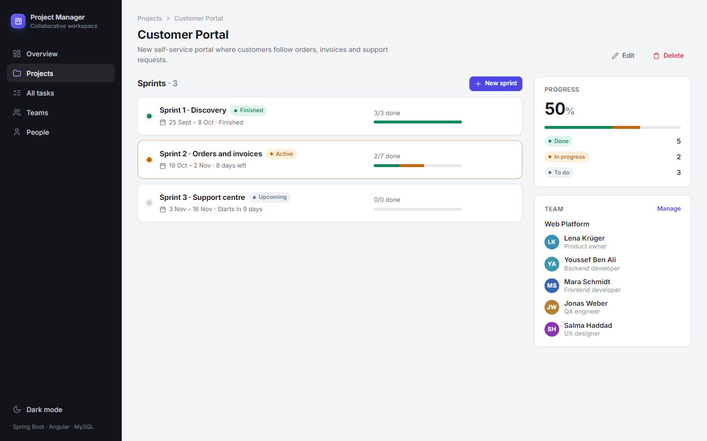

# Collaborative Project Manager

Angular client for a small team workspace: projects, teams, sprints and a drag-and-drop task board.
The data comes from the [Spring Boot API](https://github.com/aya31aidi/Collaborative_Project_Manager_Backend_).



## What it does

- **Overview**: running sprints sorted by end date, open high-priority tasks, and the open work per person.
- **Projects**: one team per project, created with an existing team or a new one in the same dialog.
- **Sprint board**: To do / In progress / Done columns. Cards move by drag and drop (mouse or touch), the status is saved
  at once and rolled back if the API refuses it. Search, filter by person or priority, tags, edit and delete from the card.
- **Teams and people**: members added and removed one by one, roles, emails, and the teams each person is in.
- **All tasks**: every task in one table, in-progress work first.
- Light and dark theme, phone layout, readable error messages from the API.

| Overview | Project |
|---|---|
|  |  |

## Run it

The API has to run first (see its README; `docker compose up --build` in its `projectmanager` folder is the quickest way).
Then, with Node 18 or 20:

```bash
npm install
npm start
```

The app opens on http://localhost:4200 and talks to http://localhost:8070. The API address lives in
`src/environments/environment.ts` (and `environment.production.ts` for `ng build`).

## Scripts

| | |
|---|---|
| `npm start` | dev server with reload |
| `npm run build` | production build in `dist/` |
| `npm test` | unit tests in Karma (watch mode) |
| `npm run test:ci` | the same tests once, in headless Chrome |

## Structure

```
src/app/
  core/       models, API services, error interceptor, toasts, confirm dialog, sprint date helpers
  shared/     icon, avatar, modal, sprint form
  pages/      dashboard, projects, project-detail, sprint-board, tasks, teams, team-detail, people
```

Angular 17 standalone components with signals and the built-in control flow; drag and drop from `@angular/cdk`.
No UI library: the look comes from the design tokens in `src/styles.css`.
